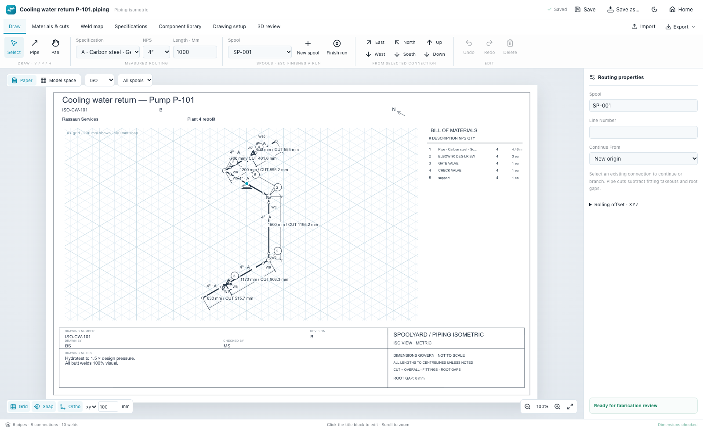
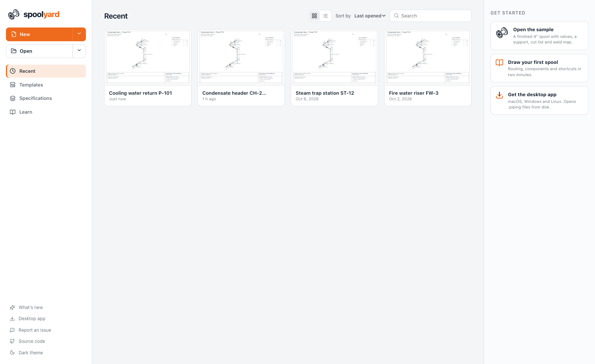
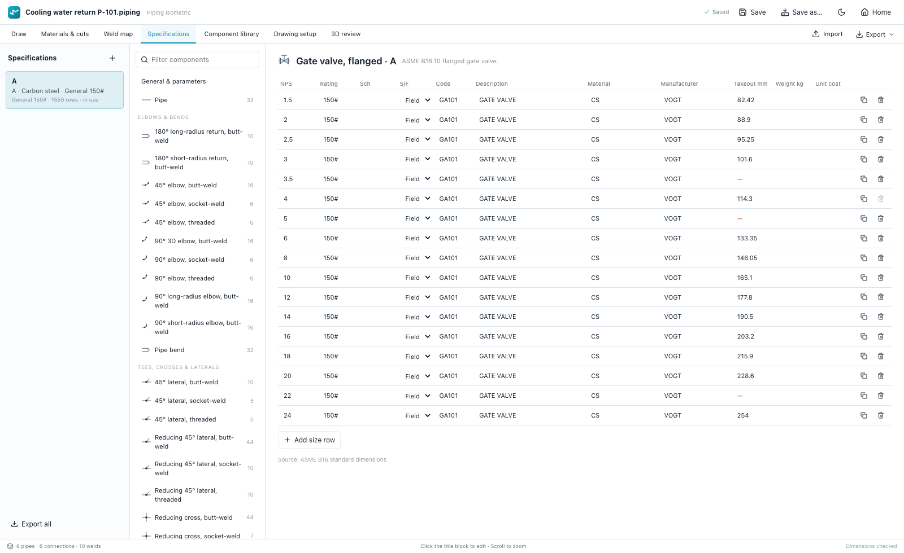
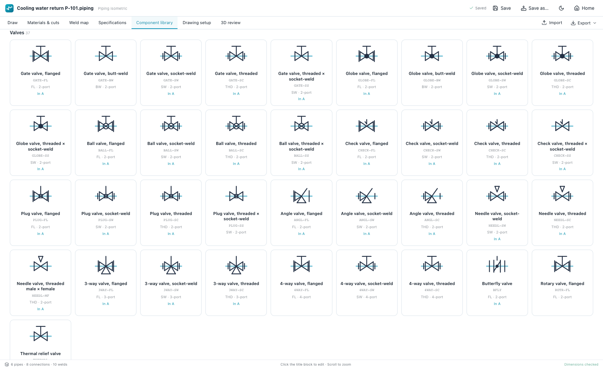
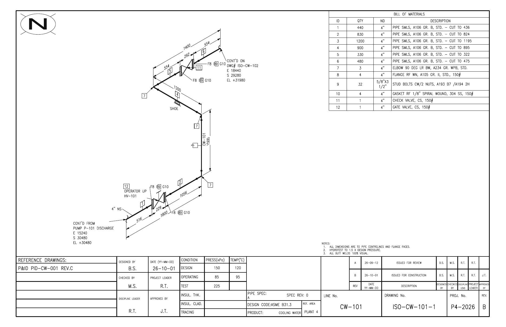

<p align="center">
  <picture>
    <source media="(prefers-color-scheme: dark)" srcset="assets/spoolyard-logo-dark.svg" />
    
  </picture>
</p>

<p align="center">
  <a href="https://braedonsaunders.github.io/spoolyard/"><b>Open in the browser</b></a> ·
  <a href="https://github.com/braedonsaunders/spoolyard/releases/latest"><b>Download for macOS / Windows</b></a> ·
  <a href="#embedding">Embed it</a>
</p>

<p align="center">
  <a href="https://github.com/braedonsaunders/spoolyard/actions/workflows/ci.yml"></a>
  <a href="LICENSE"></a>
</p>

Spoolyard is an open-source editor for piping isometrics and spool fabrication drawings. You route pipe by
measured length on isometric paper, place fittings from a pipe specification, and get the cut lengths, weld map
and bill of materials that come out of the geometry — then issue the drawing package as PDF, DXF, DWG or PCF.

It runs in the browser, as a desktop app, and inside [BidWright](https://github.com/braedonsaunders/bidwright),
where it powers piping isometrics in Files and Tools.





## What it does

- **Production isometrics.** Sheets are issued the way piping drafters draw them:
  - classic Spoolyard paper with a large drawing heading and simple bottom title block, or a detailed title grid
    with revisions (newest on top), optional logos, spool and sheet n of m;
  - a north arrow on plant north;
  - an ID / QTY / ND / DESCRIPTION bill of materials with `CUT TO` lengths;
  - boxed item tags with leaders, and `F12 B13 G14` flanged-joint callouts with gasket marks;
  - nominal sizes lettered once per size and wherever the size changes, so a row of like branches is not lettered
    again and again (Drawing setup › Size callouts can also letter every branch and olet);
  - isometric-plane dimensions and lettering;
  - continuation callouts with plant coordinates, centreline elevations, tie points, valve operators and flow arrows;
  - hatched offset triangles with their angles, set and roll.

  Drawings are laid out not to scale, so short pieces stay readable, with automatic label placement. A material
  list that would crowd its drawing moves to a sheet of its own after it, with the same title block and
  `MATERIAL LIST CONTINUED ON SHEET n` on the drawing (Drawing setup › Material list: automatic, always on the
  sheet, or always separate), and the set is numbered sheet n of m. No issued sheet overprints its lettering: on a
  sheet too dense to place a label beside its item, the label is drawn whole in the margin with a leader to the
  item, and one that finds no clear paper at all is left off and reported. A busy drawing that would crowd beside
  its list gets the sheet to itself. The next spool's parts are drawn thin beyond each break, and each break is
  lettered `CONT'D ON` with the other sheet's drawing number. Link another `.piping` file at a continuation to include a
  snapshot of its neighbouring components without adding its material or welds to this drawing.
- **Issued drawing controls.** Hold and reorder item numbers, retain verbatim issued BOM cells alongside the
  calculated values, arrange nodes on the paper without changing plant coordinates, and draft dimensions between
  selected work points, body faces or mating faces. Choose closed dimension chains or independent legacy rounding,
  body-face chains, stacked size labels and compass ticks in Drawing setup.
  Move item numbers independently of their captions, hold leader bends, adjust individual label lettering,
  repeat line identifiers on selected pipes, and control elevation callouts. Offset constructions have editable
  angle corners, radii, arrows and hatching; hoses and equipment connections can follow editable paper routes.
- **Measured routing.** Click along the six iso directions with Ortho on, or type a length and pick East, North
  or Up. On not-to-scale paper each cell of the isometric paper routes one grid block (1'-0" on a feet-and-inches
  drawing, the default), so the pointer steps cell by cell as the grid shows it; to-scale sheets draw at the largest
  standard scale that fits, or at one you choose. Bends and branches get the specification's elbows and tees
  automatically; rolling offsets route in XYZ. Click a pipe to branch off it, place olets on a header, fit reducers
  either way round, and put a valve, coupling or union on an open end with no pipe after it. A flange, cap or plug
  clicked near an open end closes it, a valve's open outlet included. Drag one fitting up against the next, or turn
  on "No pipe: fittings welded together", to weld fittings straight to each other. Choose the mating flanges a
  flanged valve comes with as you insert it, or later for both ends at once. Double-click any dimension on the sheet
  to type its length in place. Esc puts a tool down in one press, as in AutoCAD.
- **Sheets.** Each spool is a sheet. **New sheet** starts the next one; **Split sheet** (or right-click › Continue
  on a new sheet here) breaks a line onto a new sheet at a point or a connection. Window and crossing selection,
  and Copy, Ctrl+C and Ctrl+V, place copies where you pick; a branch copied with its olet goes onto the pipe it is
  pasted on.
- **Cut lengths you can build from.**
  - **Pipe cuts:** each pipe's cut is the centreline length less fitting takeouts, the specification's butt-weld
    root gap and the B31.3 socket-weld gap. Branch outlets are measured from the outside of the header.
  - **Flanged components:** a flanged valve or fitting brings its mating flanges (weld-neck, slip-on, or lap joint
    with stub end), gaskets and ASME B16.5 bolting, and their lengths come off the pipe.
  - **Joints at drawing breaks:** a joint split across drawings lists each part on one sheet only. That covers a
    stub end with its flange on the next sheet, and a flange that bolts to a lug valve (lug bolts).
  - **Field-fit welds:** they leave a makeup length on the pipe.
- **Standard dimensions built in.** Specifications supply their own rows. Anything they lack falls back to ASME
  B16.5, B16.9, B16.10, B16.11, B16.20/21, MSS SP-43, MSS SP-97 and API 609 tables, so standard components never
  need a length typed in. Where no standard dimensions a size (threaded and socket-weld valves) and a
  specification skips one size of a series, it is interpolated between the sizes either side and reported as
  calculated. Seven general-service specifications ship ready to use: carbon steel Class 150, 300 and 600 and
  stainless steel Class 150 to 900, with about 11,000 rows and complete purchase descriptions. Every row is
  editable, and you can add your own specifications, sizes and components.
- **Your own specification library.** Save a specification you have refined to your library and every new drawing
  starts from it in place of the standard one; other drawings add it from the specification lists. In the browser
  and the desktop app the library is kept on your device; inside BidWright it is your organisation's, shared by
  everyone in it. A drawing still carries its own copy, and says when it differs from the library's.
- **189 components and symbols**, each drawn on the sheet in its isometric plane. Valve symbols are distinct by
  type, and check valves point with the flow. The library also has relief valves, hoses, instruments, equipment
  nozzles, insulation and wall penetrations.
- **Weld map and BOM.**
  - **Welds:** numbered in sequence along each spool, with their type: butt, socket fillet, branch, slip-on
    fillet or attachment.
  - **Bill of materials:** grouped and ordered as plant-design isometrics list it. It counts gaskets and bolts
    per flanged joint and can hold its item numbers as issued.
  - **Checks:** short pieces and welds too close together are reported.
- **One numbering system.** The sheet's item numbers run through the cut list, material schedule, weld map and
  CSVs.
- **Paper or model space.** Draw directly on the issued sheet, or switch to an infinite isometric grid. A 3D
  review checks the routing; on a machine or browser without WebGL it opens a simplified view drawn without it.
- **Outputs:**
  - a full-page PDF package: one sheet per spool and view (and its material-list sheet), plus material, cut and
    weld schedules;
  - DXF and native DWG at true paper size with AutoCAD ROMANS lettering;
  - PCF for plant-design and stress tools;
  - SVG and CSV schedules.

| Specifications | Component library |
| --- | --- |
|  |  |



## Get it

- **Browser:** <https://braedonsaunders.github.io/spoolyard/> — drawings are kept on your device.
- **Desktop:** installers for macOS (Apple silicon and Intel), Windows and Linux are on the
  [releases page](https://github.com/braedonsaunders/spoolyard/releases/latest). The desktop app opens and saves
  `.piping` files directly and registers itself for them. The builds are not code-signed yet: on macOS,
  right-click the app and choose **Open** the first time; on Windows, choose **More info → Run anyway**.

## Run from source

```sh
pnpm install
pnpm dev          # web app on http://localhost:5173
pnpm test         # geometry, fabrication and library tests
pnpm desktop      # build and launch the desktop app
pnpm dist:mac     # or dist:win — installers in release/
```

## Embedding

The same build runs inside other applications in an iframe. Serve `dist/` from your origin (for example under
`/spoolyard/`) and load:

```
/spoolyard/index.html?embed=1&file=<url of the .piping file>&name=<file name>&theme=dark
```

In embedded mode the host draws the header and Spoolyard talks to it with `postMessage` (same origin only):

| From Spoolyard (`source: "spoolyard"`) | Meaning |
| --- | --- |
| `spoolyard:ready` | The editor has mounted. |
| `spoolyard:status` `{ status, error }` | `opening`, `saved`, `unsaved`, `saving` or `error`. |
| `spoolyard:save` `{ id, content }` | Autosave: write `content`, then reply with `spoolyard:saved` or `spoolyard:save-failed` and the same `id`. |
| `spoolyard:library` `{ id, op, specId?, spec? }` | Specification library request (`op`: `list`, `get`, `put`, `remove`), sent only to a host that offers a library. Reply with `spoolyard:library-result`. |

| From the host (`source: "spoolyard-host"`) | Meaning |
| --- | --- |
| `spoolyard:saved` / `spoolyard:save-failed` `{ id, error? }` | Result of a save. |
| `spoolyard:save-now` | Save immediately. |
| `spoolyard:theme` `{ theme: "light" \| "dark" }` | Follow the host's theme. |
| `spoolyard:capabilities` `{ library: { label } }` | In answer to `spoolyard:ready`: the host keeps the specification library (shown as "My library · `label`"). Without it the library is kept on the device. |
| `spoolyard:library-result` `{ id, ok, result?, error? }` | Answer to a library request: `list` gives summaries `{ id, name, material, service, rating, revision, rowCount, updatedAt }`, `get` the specification, `put` its summary. |

An empty file opens as a new drawing and is saved straight back, so a host can create a drawing by creating an
empty `.piping` file.

## File format

A `.piping` file is JSON (`"schema": "bidwright-piping"`, version 1): the title block, the embedded
specifications, and the measured nodes and pipe runs in millimetres. Embedding the specifications keeps every
drawing self-contained. DXF exports carry the same model in an XRECORD, so Spoolyard can reopen its own DXF.

## License

[AGPL-3.0](LICENSE). DWG export uses [GNU LibreDWG](https://www.gnu.org/software/libredwg/) 0.14 compiled to
WebAssembly (GPL-3.0-or-later, see `public/dwg-export/COPYING`; its source and reproducible build are in
`public/dwg-export/SOURCE.md` and `scripts/build-dwg-export.sh`); PDFs embed Noto Sans (SIL Open Font License, see
`public/fonts/LICENSE`).
